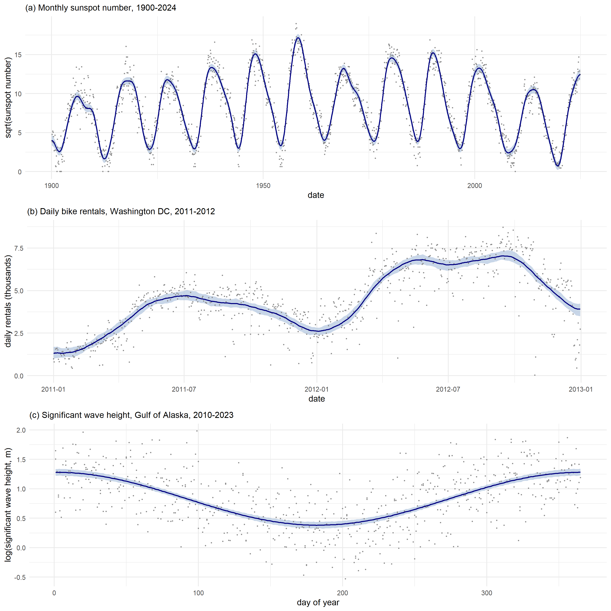

# Large series priors

[](https://www.r-project.org/)
[](https://lean-lang.org/)
[](#citation-and-license)

This repository has the code, the paper and the Lean proofs for **Large series priors for adaptive and optimal Bayesian nonparametric regression**, by Felipe Bedoya and Meng Li (Department of Statistics, Rice University).

## The idea

A random series prior usually needs a prior on the number of terms, and that forces the sampler to move between models of different dimension. We skip that step. We expand the regression function in a **large, fixed** dictionary of J_n ≍ n^b functions and let a **Horseshoe prior** on the coefficients decide which terms matter. The paper works with three dictionaries: Fourier, B-splines, and tensor-product Chebyshev polynomials. With the dictionary fixed, the posterior is that of an ordinary Bayesian linear regression.

On the theory side, Theorem 1 gives posterior contraction for product shrinkage priors under prior-mass conditions adapted from Wei and Ghosal (2020). Corollary 1 turns this into adaptive contraction rates over anisotropic Hölder-type classes, using one prior fixed in advance. The rate is driven mainly by how sparsely the dictionary represents the true function.

On the computing side, a fixed dictionary means a fixed design matrix, and for the dictionary and design pairs of the paper its Gram matrix X'X has a simple form: diagonal for the Chebyshev dictionary at the Gauss–Chebyshev nodes, diagonal plus rank one for the Fourier dictionary on an equally spaced grid, and banded for cubic B-splines. [`sampler/`](sampler) has `hs_fast()`, an exact Horseshoe Gibbs sampler that uses this structure: the coefficient draw then costs O(J_n) per sweep instead of O(J_n³). For other designs, `hs_fast()` checks the supplied Gram matrix against these forms and uses a structured draw whenever one of them holds; otherwise, for example for the Chebyshev dictionary on an equally spaced grid, it uses a verified dense fallback. It targets the exact posterior by default, and with `floor = "package"` it reproduces the [`horseshoe`](https://CRAN.R-project.org/package=horseshoe) package draw for draw.



*Figure 4 of the paper: posterior means (navy) and 95% bands for the three real-data examples, all fitted with the same rules.*

## What's here

Every figure and table of the paper comes from a script in this repository.

| In the paper | Folder | How to run (from that folder) | Time |
|---|---|---|---|
| §3.1: Figure 1, coefficient recovery | [`simulations/recovery/`](simulations/recovery) | `Rscript recovery.R`, then `Rscript make_figure.R` | about 10 s |
| §3.2: Table 1, Figure 2, comparison with least squares and ridge | [`simulations/benchmarks/`](simulations/benchmarks) | `Rscript benchmarks.R`, then `Rscript make_table.R` and `Rscript make_figure.R` | about 30 s |
| §3.3: Table 2, Figure 3, empirical rates | [`simulations/scaling/`](simulations/scaling) | from the shipped results: `Rscript summarize.R --from=reference_outputs`, then `Rscript make_figures.R --from=reference_outputs` | seconds; the full experiment is 400 cluster tasks, about 8 core-hours |
| §3.4: Figure 4, three real series | [`applications/`](applications) | `Rscript code/prep_buoy.R`, `Rscript code/prep_sunspots.R`, `Rscript code/prep_bike.R`, `Rscript code/run_applications.R`, `Rscript code/make_figure.R`; from the shipped fits: `Rscript code/make_figure.R --from=reference_outputs` | about 45 min; seconds from the shipped fits |
| §3.5 and Appendix E: the sampler; Table 3, timings | [`sampler/`](sampler) | `Rscript timing.R`; the paper's table from the shipped numbers: `Rscript make_table.R`; four validation scripts in `checks/` | about 2 min; checks 10 s to 3 min each |
| The paper itself, with all proofs | [`paper/`](paper) | read `large_series_priors.pdf`, or `cd Overleaf && latexmk -pdf main.tex` | |
| Theorem 1, Corollary 1, the sparse approximation lemmas | [`lean/`](lean) | `lake build`, then `lake env lean AxiomCheck.lean` | about 15 min with the Mathlib cache |

Each folder has its own README with the settings, the commands and the outputs. The commands above are typed in the folder named in the same row; every R script finds its own location and writes inside its folder, so nothing needs editing. Scripts that fit a model accept `--quick` for a fast smoke test (the scripts that only prepare data, summarize or draw do not need it).

The folders `applications/`, `sampler/`, `simulations/recovery/`, `simulations/benchmarks/` and `simulations/scaling/` also ship `reference_outputs/` (small CSV files, text summaries and figures; no posterior draws), so you can compare without rerunning:

- Sections 3.1 and 3.2 rerun in under a minute each. The shipped outputs are such reruns at the paper's settings; they agree with the runs reported in the paper to rounding error, and they give every entry of Table 1 and every number quoted in Section 3.1 as printed.
- For Section 3.3, the shipped per-fit results of the paper's run (15,600 fits) give Table 2, Figure 3 and the numbers quoted in the text. A single task of the experiment can be rerun on a laptop and compared with its shipped rows.
- For the sampler, the shipped Table 3 holds the paper's timings (they depend on the machine), and the four validation scripts print PASS or FAIL.
- For Section 3.4, the shipped fitted curves and bands of the three series redraw Figure 4 without fitting. Rerunning the buoy example reproduces its shipped fit byte for byte.
- The Lean build has no `sorry` and uses only Lean's three standard axioms. It covers Theorem 1, Corollary 1 and the sparse approximation lemmas for all three dictionaries; the classical approximation inputs enter as explicit hypotheses.

## Requirements

**R.** The paper's simulations ran under R 4.5.2 and the applications under R 4.4.1; the scripts here were also checked under R 4.6.0.

- [`sampler/`](sampler) and [`simulations/`](simulations) need a C++ compiler and the packages `Rcpp`, `RcppArmadillo` and `digest`; the sampler compiles itself the first time it is sourced. Figures use base R graphics with cairo. `splines` ships with R.
- [`applications/`](applications) uses the [`horseshoe`](https://CRAN.R-project.org/package=horseshoe) package, version 0.2.0, as the paper does for these fits, plus `ggplot2` for the figure and `digest` for the data checksums. One of the sampler's validation scripts also compares against `horseshoe` 0.2.0.
- `horseshoe` is archived on CRAN, so `install.packages("horseshoe")` no longer finds it. Install version 0.2.0 from the CRAN archive:

  ```r
  install.packages("https://cran.r-project.org/src/contrib/Archive/horseshoe/horseshoe_0.2.0.tar.gz",
                   repos = NULL, type = "source")
  ```

**Lean.** Install [elan](https://github.com/leanprover/elan). It fetches the pinned toolchain and Mathlib for you.

**LaTeX.** A full TeX Live, only if you want to recompile the paper.

## Data

The three applications use public data:

- **NOAA buoy files** are included.
- **SILSO sunspots**: the prepared monthly series the paper used (January 1900 to December 2024) is included, with attribution, under SILSO's CC BY-NC 4.0 licence. The prep script rebuilds it from a fresh download and checks that it is unchanged.
- **UCI bike-sharing data** are downloaded by the prep script and checked against the hashes from the paper's run.

Sources and citations are in [`applications/README.md`](applications/README.md).

## Citation and license

`CITATION.cff` has the reference; GitHub shows it under "Cite this repository".

The repository is MIT-licensed (see [`LICENSE`](LICENSE)), with one exception: the folder [`sampler/`](sampler) is distributed under the GNU General Public License, version 3 (see [`sampler/LICENSE`](sampler/LICENSE)), because `hs_fast()` adapts code from the R package [`horseshoe`](https://CRAN.R-project.org/package=horseshoe) 0.2.0 by Stéphanie van der Pas, James Scott, Antik Chakraborty and Anirban Bhattacharya, which is GPL-3. We thank its authors. The third-party data stay under their providers' terms.

Questions or problems? Please open an issue.
